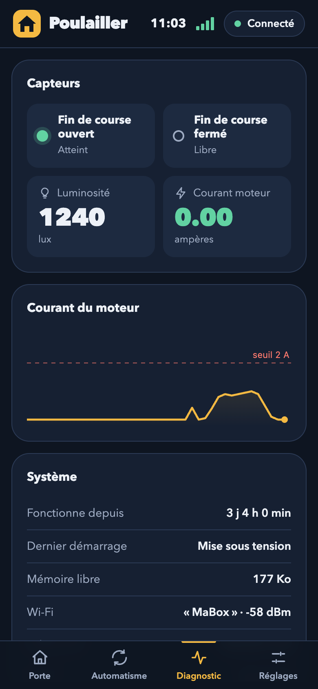
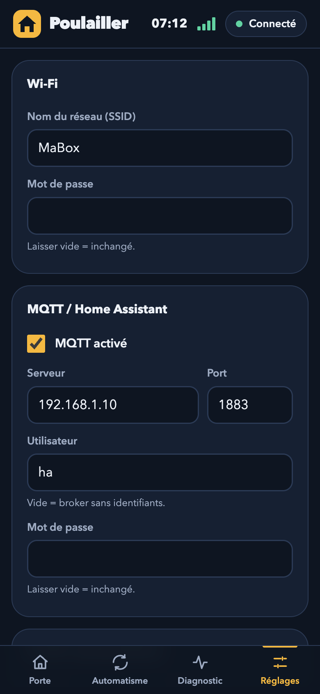

# 🐔 Porte de poulailler automatique - Compatible Home Assistant — Rétrofit Porte marque Omlet (FR) mais compatible à tous projets DIY
[English version available below](#-automatic-chicken-coop-door--omlet-autodoor-retrofit---english-version)

Contrôleur basé sur ESP32 pour automatiser une porte de poulailler coulissante, en récupérant la mécanique d'une porte Omlet Autodoor existante. 
Intégration Home Assistant possible via MQTT, interface web mobile embarquée, 4 modes de gestion.

Le projet peut fonctionner avec n'importe quel autre bricolage de porte DIY.

<p align="center">
  
  
  
  
</p>

---

## Contexte

Après deux portes HS (mais moteur Ok), et quelques poules croquées par un renard plus tard... je décide de supprimer le panneau de commande de la porte automatique Omlet pour ne conserver que la mécanique.

Le projet part d'une porte automatique de la marque Omlet dont on conserve uniquement la mécanique (moteur 014.0077, rail, porte coulissante). L'électronique d'origine est remplacée par un contrôleur ESP32.
Par contre exit le capteur de pression latérale qui détecte la présence d'un objet (poule ?) sur la route. C'est trop souvent la source de dysfonctionnement et d'erreur, ce principe sera géré par une surtension détectée sur le moteur.

La porte coulisse **horizontalement** : droite → gauche pour ouvrir, gauche → droite pour fermer.

---

## Fonctionnalités

- **4 modes de gestion** : soleil (calcul NOAA lever/coucher), luminosité (seuils lux + confirmation), heure fixe, manuel
- **Intégration Home Assistant** via MQTT Discovery : les entités sont créées automatiquement
- **Interface web mobile-first** embarquée sur l'ESP32 (WebSocket, temps réel)
- **Sécurités** : fins de course magnétiques, détection surcourant (ACS712), timeout moteur
- **Override manuel** : commande manuelle suspend l'automatisme jusqu'à la prochaine échéance
- **Persistance des paramètres** : sauvegarde NVS Flash
- **Heure été/hiver automatique** : fuseau horaire POSIX France (CET-1CEST,M3.5.0,M10.5.0/3)
- **Démarrage progressif** : rampe PWM pour limiter le pic de courant
- **Mise à jour sans fil (OTA)** : téléversement depuis l'IDE Arduino via le WiFi

---

## Matériel requis

| Composant | Référence | Rôle |
|---|---|---|
| Microcontrôleur | ESP32-WROOM-32U DevKitC | Cerveau + WiFi + serveur web |
| Contrôleur moteur | BTS7960 / IBT-2 | Pilotage moteur bidirectionnel PWM |
| Fins de course | MC-38 × 2 | Détection position ouverte/fermée |
| Capteur courant | ACS712 5A | Détection surcourant / blocage |
| Capteur luminosité | BH1750 (GY-30) | Mode luminosité + log |
| Convertisseur | LM2596S | 12V → 5V alimentation ESP32 |
| Alimentation | 12V 2A | Alimentation principale pour le moteur |
| Boîtier | 190×150×75 mm IP67 ABS | Protection étanche extérieure |
| Câble signal | Câble alarme 4×0.22mm² | FDC et BH1750 vers boîtier |


---

## Logiciel

### Structure du projet

```
porte_poulailler/
├── porte_poulailler.ino   ← Logique principale (moteur, modes, MQTT, NVS)
├── web_server_v2.ino      ← Serveur web + WebSocket + HTML embarqué
├── secrets.h.example      ← Modèle des identifiants (publié)
└── secrets.h              ← Tes identifiants (à créer, ignoré par git)
```

> Les deux fichiers `.ino` doivent être dans le même dossier. L'IDE Arduino les compile automatiquement ensemble.

### Dépendances

Installer via le gestionnaire de bibliothèques Arduino :

| Bibliothèque | Auteur |
|---|---|
| PubSubClient | Nick O'Leary |
| ArduinoJson (**v7**) | Benoit Blanchon |
| BH1750 | Christopher Laws |
| ESP Async WebServer | **ESP32Async** (github.com/ESP32Async/ESPAsyncWebServer) |
| AsyncTCP | **ESP32Async** (github.com/ESP32Async/AsyncTCP) |

> Package ESP32 Arduino **v3.x** requis (testé en 3.3.12). ArduinoOTA est inclus dans le package.

> ⚠️ Utiliser les forks **ESP32Async** et non les dépôts originaux me-no-dev (archivés).

### Configuration Arduino IDE

Package ESP32 — ajouter dans Fichier → Préférences → URLs supplémentaires :
```
https://raw.githubusercontent.com/espressif/arduino-esp32/gh-pages/package_esp32_index.json
```

Paramètres de carte :

| Paramètre | Valeur |
|---|---|
| Board | ESP32 Dev Module |
| Upload Speed | 921600 |
| CPU Frequency | 240MHz (WiFi/BT) |
| Flash Mode | QIO |
| Flash Frequency | 80MHz |
| Flash Size | 4MB (32Mb) |
| Partition Scheme | Minimal SPIFFS (1.9MB APP with OTA/128KB SPIFFS) |
| PSRAM | Disabled |

> Le schéma « Minimal SPIFFS » est nécessaire pour l'OTA : le programme occupe ~60 % des 1,9 Mo (il ne tient qu'à ~93 % dans le schéma par défaut).

### Mise à jour sans fil (OTA)

Après un premier téléversement par USB, les suivants peuvent se faire par le WiFi :
dans l'IDE, **Outils → Port** → choisir le port réseau `poulailler` (ou l'IP de l'ESP32), puis Téléverser.
Le moteur est coupé au début de la mise à jour et l'ESP32 redémarre à la fin : faire la mise à jour porte immobile.

---

## Configuration

### Identifiants et position : `secrets.h` (valeurs par défaut)

Les identifiants WiFi / MQTT et les coordonnées GPS ne sont **pas** dans le code : ils sont lus depuis `porte_poulailler/secrets.h`, un fichier ignoré par git pour ne jamais publier tes mots de passe.
Ce sont les **valeurs d'usine** : une fois la carte en service, tout se modifie depuis l'onglet **Réglages** de la page web (voir [Interface web](#interface-web)) sans recompiler. Les valeurs enregistrées sont stockées en NVS et prennent le pas sur `secrets.h`, qui reste le **repli** si le Wi-Fi enregistré est injoignable.

1. Copier le modèle :
   ```bash
   cp porte_poulailler/secrets.h.example porte_poulailler/secrets.h
   ```
2. Renseigner tes valeurs dans `secrets.h` :
   ```cpp
   #define SECRET_WIFI_SSID      "TON_SSID"
   #define SECRET_WIFI_PASSWORD  "TON_MOT_DE_PASSE"

   #define SECRET_MQTT_SERVER    "192.168.1.XX"   // IP du broker Home Assistant
   #define SECRET_MQTT_USER      "mqtt_user"
   #define SECRET_MQTT_PASS      "mqtt_password"

   #define SECRET_LATITUDE       48.8566          // Coordonnées GPS pour calcul soleil
   #define SECRET_LONGITUDE      2.3522

   // Facultatif : mot de passe du point d'accès de secours (8 caractères minimum, défaut : "poulailler")
   // #define SECRET_AP_PASSWORD "mon_mot_de_passe"
   ```
3. Compiler normalement : `secrets.h` apparaît comme un onglet dans l'IDE Arduino.

> Sans `secrets.h`, la compilation échoue avec `secrets.h: No such file or directory`.
> Ne jamais committer `secrets.h` (il est listé dans `.gitignore`) ; seul `secrets.h.example` est publié.

### Autres paramètres dans `porte_poulailler.ino`

```cpp
const char* TZ_INFO   = "CET-1CEST,M3.5.0,M10.5.0/3";  // Fuseau horaire (France)
```

### Paramètres à calibrer après montage

```cpp
#define ACS712_ZERO_ADC   3050  // Valeur ADC à 0A — mesurer à moteur arrêté
#define ACS712_SEUIL_ADC  310   // Delta déclenchant le surcourant (~2.7A)
#define PWM_DUTY_9V       191   // Duty cycle ouverture (~9V sur alim 12V)
#define PWM_DUTY_FER      140   // Duty cycle fermeture (~7V, plus doux)
#define TIMEOUT_OUV_MS    15000 // Timeout ouverture en ms
#define TIMEOUT_FER_MS    20000 // Timeout fermeture en ms
#define RAMPE_MS          300   // Durée rampe PWM démarrage moteur
#define SURCOURANT_MASQUAGE_MS    500  // Pic de démarrage ignoré après la rampe
#define SURCOURANT_CONFIRMATIONS  3    // Mesures consécutives avant arrêt
```

---

## Câblage

### Affectation des pins ESP32

| GPIO | Composant | Signal |
|---|---|---|
| 25 | BTS7960 | RPWM (ouverture) |
| 26 | BTS7960 | LPWM (fermeture) |
| 27 | BTS7960 | EN (R_EN + L_EN reliés) |
| 32 | MC-38 gauche | FDC position ouverte |
| 33 | MC-38 droit | FDC position fermée |
| 34 | ACS712 | OUT (analogique) |
| 21 | BH1750 | SDA |
| 22 | BH1750 | SCL |
| VIN | LM2596S | 5V sortie |
| GND | Tous | Masse commune |

### ACS712 — câblage en série sur M+

```
BTS7960 (OUT+) → ACS712 (IP+) → (IP−) → Moteur (M+)
Moteur (M−) → BTS7960 (OUT−)
```

### MC-38 — fins de course

Câblage sans polarité (interchangeable) :
- Un fil → GPIO32 (OUV) ou GPIO33 (FER)
- L'autre fil → GND

Comportement NO : aimant présent → contact fermé → pin LOW.

### BH1750

```
VCC  → 3.3V ESP32
GND  → GND commun
SCL  → GPIO22
SDA  → GPIO21
ADDR → Non connecté (adresse 0x23)
```

---

## Topics MQTT

| Topic | Direction | Valeurs |
|---|---|---|
| `poulailler/porte/etat` | Publish | `open` / `closed` / `opening` / `closing` / `error` |
| `poulailler/porte/commande` | Subscribe | `OPEN` / `CLOSE` / `STOP` / `RESET` |
| `poulailler/capteurs/lux` | Publish | Float (lux) |
| `poulailler/capteurs/courant` | Publish | Float (ampères) |
| `poulailler/soleil/heures` | Publish | JSON lever/coucher/ouverture/fermeture |
| `poulailler/porte/etat_texte` | Publish | État lisible (`Ouverte`, `Fermee`…) |
| `poulailler/fdc/ouvert` · `poulailler/fdc/ferme` | Publish | `ON` / `OFF` |
| `poulailler/status` | Publish (LWT) | `online` / `offline` |
| `poulailler/wifi/rssi` · `poulailler/wifi/qualite` | Publish | dBm · % |
| `poulailler/mode` | Pub/Sub | `soleil` / `luminosite` / `heure_fixe` / `manuel` |
| `poulailler/config` | Subscribe | JSON de configuration complet |
| `poulailler/param/<nom>` | Pub/Sub (retain) | `offset_ouv`, `offset_fer`, `lux_ouv`, `lux_fer`, `lux_conf`, `hfx_ouv_h`, `hfx_ouv_m`, `hfx_fer_h`, `hfx_fer_m` |

Les valeurs reçues sont bornées (offsets soleil −60 à +120 min, heure fixe −120 à +120 min, confirmation lux 10 à 300 s…) et ne sont enregistrées que si elles changent.

---

## Home Assistant

L'ESP32 déclare lui-même ses entités par **MQTT Discovery** (appareil « Porte Poulailler ») : porte (cover), mode (select), capteurs (luminosité, courant, heures soleil, WiFi, fins de course) et réglages (number). Elles passent en « indisponible » si l'ESP32 se déconnecte.

Le fichier `home_assistant_poulailler_v2.yaml` est un **complément facultatif** : capteurs dérivés (lever/coucher…), alertes (erreur porte, ESP32 hors ligne, porte ouverte la nuit, surcourant) et exemple de tableau de bord. Il ne redéclare pas les entités MQTT, pour éviter les conflits d'`unique_id`.

---

## Modes de gestion

### Mode Soleil
Calcul astronomique NOAA embarqué. Ouvre après le lever + offset, ferme après le coucher + offset. Offsets configurables de −60 à +120 minutes.

### Mode Luminosité
Ouvre si luminosité > seuil pendant une durée de confirmation (évite les fausses détections nuageuses). Ferme si luminosité < seuil pendant la même durée (10 à 300 s).

### Mode Heure Fixe
Heures d'ouverture et fermeture définies manuellement, avec offsets optionnels (−120 à +120 min). Une plage qui passe minuit est gérée.

### Mode Manuel
Aucune automatisation. Commandes uniquement via interface web ou MQTT.

### Override manuel
En modes automatiques, une commande manuelle suspend l'automatisme jusqu'à la prochaine échéance naturelle (lever/coucher ou 30 min en mode luminosité). Un badge jaune s'affiche dans l'interface.

---

## Interface web

Accessible à `http://[IP_ESP32]` depuis n'importe quel navigateur sur le réseau local.
IP visible au démarrage de l'ESP32 dans le moniteur Arduino.

La page est organisée en **4 onglets** (barre en bas de l'écran, lien direct possible : `#porte`, `#auto`, `#diag`, `#reglages`) :

| Onglet | Contenu |
|---|---|
| **Porte** | État temps réel + heure ESP32, mode actif et prochaine action, boutons Ouvrir / Fermer / Stop d'urgence (double confirmation), bouton Réinitialiser l'erreur (visible uniquement en état erreur) |
| **Automatisme** | Choix du mode (Soleil, Luminosité, Heure fixe, Manuel), décalages, seuils lux, heures fixes, programme du jour |
| **Diagnostic** | Fins de course, luminosité, courant moteur + graphique, système (durée de fonctionnement, cause du dernier démarrage, mémoire libre, Wi-Fi, IP, état MQTT, version), journal des événements (20 entrées) |
| **Réglages** | Wi-Fi (SSID, mot de passe), MQTT (serveur, port, utilisateur, mot de passe, activation), position GPS, mot de passe de l'onglet, bouton Redémarrer |

### Onglet Réglages

- **Position GPS** : appliquée immédiatement (recalcul du lever/coucher). Astuce : clic droit sur Google Maps pour copier les coordonnées.
- **Wi-Fi / MQTT** : enregistrés en NVS, la carte **redémarre** pour les appliquer (jamais pendant un mouvement : le redémarrage attend que la porte soit immobile). Un champ mot de passe laissé vide conserve l'ancien.
- **Les mots de passe ne sont jamais renvoyés** au navigateur.
- **Mot de passe de l'onglet** : tant qu'aucun n'est défini, les réglages sont ouverts à tout le réseau local (une bannière le rappelle). Une fois défini (6 à 32 caractères ASCII), il est demandé pour lire et modifier les réglages ; 5 erreurs bloquent les essais pendant 1 minute. La page reste en HTTP non chiffré : c'est une protection contre les erreurs et les curieux, pas contre une écoute du réseau local. Les commandes de la porte (onglet Porte) ne sont pas protégées. **Mot de passe oublié** : effacer la NVS (`esptool.py erase_region 0x9000 0x5000`) puis téléverser à nouveau — tous les réglages repartent aux valeurs de `secrets.h`.
- **Filet de sécurité Wi-Fi** : au démarrage, la carte essaie le Wi-Fi enregistré, puis celui de `secrets.h`, puis ouvre son propre point d'accès **`Poulailler-Config`** (mot de passe `poulailler` par défaut, `SECRET_AP_PASSWORD` pour le changer) : se connecter dessus puis ouvrir `http://192.168.4.1` pour corriger les réglages. Sans internet, il n'y a pas d'heure fiable : les modes Soleil et Heure fixe sont inactifs, le mode Luminosité continue de fonctionner. Le point d'accès se coupe tout seul dès que le Wi-Fi revient (nouvelle tentative toutes les 5 minutes).

---

## Sécurités

| Protection | Condition | Action |
|---|---|---|
| Fins de course | FDC atteint pendant mouvement | Arrêt immédiat |
| Timeout ouverture | FDC non atteint après 15s | Arrêt + état ERREUR |
| Timeout fermeture | FDC non atteint après 20s | Arrêt + état ERREUR |
| Surcourant ACS712 | Courant > seuil (~2.7A) sur 3 mesures consécutives, après 500 ms de masquage du pic de démarrage | Arrêt + état ERREUR |
| Garde universelle | Moteur actif hors mouvement | PWM forcé à 0 |

Pendant un mouvement, la boucle principale ne fait aucun appel bloquant (pas de reconnexion MQTT, heure lue sans attente) : les fins de course sont lues toutes les ~10-20 ms. Un changement de mode demandé pendant un mouvement est appliqué dès l'arrêt de la porte.

En état ERREUR : bouton **Réinitialiser** dans l'interface ou commande MQTT `RESET` sur `poulailler/porte/commande`.

---

## Calibration ACS712

```cpp
// Sketch de test rapide
#define PIN_ACS712    34
#define ACS712_ZERO_ADC 3050  // Valeur à remplacer

void setup() {
  Serial.begin(115200);
  analogReadResolution(12);
  analogSetAttenuation(ADC_11db);
}
void loop() {
  int raw = analogRead(PIN_ACS712);
  float amperes = abs(raw - ACS712_ZERO_ADC) / 115.0;
  Serial.printf("RAW: %d  |  Courant: %.2f A\n", raw, amperes);
  delay(500);
}
```

1. Téléverser ce sketch moteur **débranché**
2. Relever la valeur RAW moyenne → c'est `ACS712_ZERO_ADC`
3. Brancher le moteur, faire tourner sans blocage → noter le delta max
4. Bloquer manuellement la porte → noter le delta en blocage
5. Placer `ACS712_SEUIL_ADC` à mi-chemin entre les deux

---

## Dépannage

| Symptôme | Solution |
|---|---|
| `[BH1750] Device is not configured!` | Vérifier SDA→21, SCL→22, VCC→3.3V, GND |
| ESP32 reboot au démarrage moteur | Ajouter condensateur 470µF sur sortie 5V LM2596S, ou alimenter l'ESP32 via USB indépendant |
| Surcourant intempestif | Recalibrer ACS712_ZERO_ADC avec sketch de test |
| Le mode revient tout seul | Purger un ancien retain : publier un payload vide (retain) sur `poulailler/mode` dans HA |
| Entités HA en double / conflit `unique_id` | Retirer l'ancien bloc `mqtt:` de `configuration.yaml` : les entités viennent de la Discovery |
| `secrets.h: No such file or directory` | Créer `secrets.h` à partir de `secrets.h.example` |
| Port réseau `poulailler` absent dans l'IDE | Vérifier que l'ESP32 est sur le même réseau ; à défaut, téléverser par USB |
| `[INIT] Position inconnue` | Déplacer la porte sur un FDC manuellement puis redémarrer |
| Interface web inaccessible | Vérifier l'IP dans le moniteur série (115200 bauds) ; sinon se connecter au Wi-Fi `Poulailler-Config` puis `http://192.168.4.1` |
| Réglages Wi-Fi erronés, carte injoignable | Elle retombe sur `secrets.h`, puis sur le point d'accès `Poulailler-Config` (voir Interface web) |

---

## Licence

Projet personnel DIY — libre de réutilisation et d'adaptation.

---

## Soutenir le projet

Ce projet vous rend service ? Vous pouvez soutenir son développement :

<a href="https://www.buymeacoffee.com/kraftpunk"></a>


---


# 🐔 Automatic Chicken Coop Door — Omlet Autodoor Retrofit - ENGLISH VERSION

DIY ESP32-based controller to automate a sliding chicken coop door, reusing the mechanics of an existing Omlet Autodoor. Home Assistant integration via MQTT, embedded mobile-first web interface, 4 management modes.

It can works with any DIY door.

**The web version isn't available in English. Feel free to open a new GitHub issue to request it.**

---

## Context

This project reuses the mechanics of an Omlet Autodoor (motor 014.0077, rail, sliding door) while replacing the original electronics with a fully DIY ESP32 controller.

The door slides **horizontally**: right → left to open, left → right to close.

---

## Features

- **4 management modes**: sun (NOAA sunrise/sunset calculation), luminosity (lux thresholds + confirmation delay), fixed time, manual
- **Home Assistant integration** via MQTT Discovery: entities are created automatically
- **Embedded mobile-first web interface** on the ESP32 (WebSocket, real-time)
- **Safety systems**: magnetic limit switches, overcurrent detection (ACS712), motor timeout, universal guard
- **Manual override**: a manual command temporarily suspends automation until the next scheduled event
- **Parameter persistence**: NVS Flash storage, survives reboots
- **Automatic DST handling**: POSIX timezone string for France (CET-1CEST,M3.5.0,M10.5.0/3)
- **Soft motor start**: PWM ramp to limit inrush current
- **Over-the-air updates (OTA)**: upload from the Arduino IDE over WiFi

---

## Hardware

| Component | Reference | Role |
|---|---|---|
| Microcontroller | ESP32-WROOM-32U DevKitC | Brain + WiFi + web server |
| Motor driver | BTS7960 / IBT-2 | Bidirectional PWM motor control |
| Limit switches | MC-38 × 2 | Open/closed position detection |
| Current sensor | ACS712 5A | Overcurrent / jam detection |
| Light sensor | BH1750 (GY-30) | Luminosity mode + logging |
| Voltage converter | LM2596S (adjustable) | 12V → 5V for ESP32 |
| Power supply | 12V 2A | Main power |
| Enclosure | 190×150×75 mm IP67 ABS | Weatherproof outdoor housing |
| Signal cable | 4-wire alarm cable 0.22mm² | Limit switches and BH1750 to enclosure |

---

## Software

**The web version isn't available in English. Feel free to open a new GitHub issue to request it.**

### Project structure

```
porte_poulailler/
├── porte_poulailler.ino   ← Main logic (motor, modes, MQTT, NVS)
├── web_server_v2.ino      ← Web server + WebSocket + embedded HTML
├── secrets.h.example      ← Credentials template (published)
└── secrets.h              ← Your credentials (to create, git-ignored)
```

> Both `.ino` files must be in the same folder. The Arduino IDE compiles them together automatically.

### Dependencies

Install via the Arduino Library Manager:

| Library | Author |
|---|---|
| PubSubClient | Nick O'Leary |
| ArduinoJson (**v7**) | Benoit Blanchon |
| BH1750 | Christopher Laws |
| ESP Async WebServer | **ESP32Async** (github.com/ESP32Async/ESPAsyncWebServer) |
| AsyncTCP | **ESP32Async** (github.com/ESP32Async/AsyncTCP) |

> ESP32 Arduino core **v3.x** required (tested with 3.3.12). ArduinoOTA ships with the core.

> ⚠️ Use the **ESP32Async** forks — the original me-no-dev repositories are archived.

### Arduino IDE configuration

ESP32 package — add in File → Preferences → Additional Board Manager URLs:
```
https://raw.githubusercontent.com/espressif/arduino-esp32/gh-pages/package_esp32_index.json
```

Board settings:

| Parameter | Value |
|---|---|
| Board | ESP32 Dev Module |
| Upload Speed | 921600 |
| CPU Frequency | 240MHz (WiFi/BT) |
| Flash Mode | QIO |
| Flash Frequency | 80MHz |
| Flash Size | 4MB (32Mb) |
| Partition Scheme | Minimal SPIFFS (1.9MB APP with OTA/128KB SPIFFS) |
| PSRAM | Disabled |

> The "Minimal SPIFFS" scheme is required for OTA: the sketch uses ~60% of the 1.9 MB (it only fits at ~93% with the default scheme).

### Over-the-air updates (OTA)

After a first USB upload, later uploads can go over WiFi:
in the IDE, **Tools → Port** → pick the `poulailler` network port (or the ESP32 IP), then Upload.
The motor is switched off when the update starts and the ESP32 reboots at the end: update while the door is idle.

---

## Configuration

### Credentials and location: `secrets.h` (default values)

WiFi / MQTT credentials and GPS coordinates are **not** in the code: they are read from `porte_poulailler/secrets.h`, a git-ignored file so your passwords are never published.
These are the **factory values**: once the board is running, everything can be changed from the **Settings** tab of the web page (see [Web interface](#web-interface)) without recompiling. Saved values are stored in NVS and take precedence over `secrets.h`, which remains the **fallback** if the saved WiFi is unreachable.

1. Copy the template:
   ```bash
   cp porte_poulailler/secrets.h.example porte_poulailler/secrets.h
   ```
2. Fill in your values in `secrets.h`:
   ```cpp
   #define SECRET_WIFI_SSID      "YOUR_SSID"
   #define SECRET_WIFI_PASSWORD  "YOUR_PASSWORD"

   #define SECRET_MQTT_SERVER    "192.168.1.XX"   // Home Assistant broker IP
   #define SECRET_MQTT_USER      "mqtt_user"
   #define SECRET_MQTT_PASS      "mqtt_password"

   #define SECRET_LATITUDE       48.8566          // GPS coordinates for sun calculation
   #define SECRET_LONGITUDE      2.3522

   // Optional: fallback access point password (8 characters minimum, default: "poulailler")
   // #define SECRET_AP_PASSWORD "my_password"
   ```
3. Compile as usual: `secrets.h` shows up as a tab in the Arduino IDE.

> Without `secrets.h`, compilation fails with `secrets.h: No such file or directory`.
> Never commit `secrets.h` (it is listed in `.gitignore`); only `secrets.h.example` is published.

### Other parameters in `porte_poulailler.ino`

```cpp
const char* TZ_INFO   = "CET-1CEST,M3.5.0,M10.5.0/3";  // Time zone (France)
```

### Parameters to calibrate after assembly

```cpp
#define ACS712_ZERO_ADC   3050   // ADC value at 0A — measure with motor stopped
#define ACS712_SEUIL_ADC  310    // Delta triggering overcurrent (~2.7A)
#define PWM_DUTY_9V       191    // Opening duty cycle (~9V on 12V supply)
#define PWM_DUTY_FER      140    // Closing duty cycle (~7V, softer)
#define TIMEOUT_OUV_MS    15000  // Opening timeout in ms
#define TIMEOUT_FER_MS    20000  // Closing timeout in ms
#define RAMPE_MS          300    // PWM ramp duration at motor start
#define SURCOURANT_MASQUAGE_MS    500  // Start-up spike ignored after the ramp
#define SURCOURANT_CONFIRMATIONS  3    // Consecutive readings before stopping
```

---

## Wiring

### ESP32 pin assignment

| GPIO | Component | Signal |
|---|---|---|
| 25 | BTS7960 | RPWM (opening) |
| 26 | BTS7960 | LPWM (closing) |
| 27 | BTS7960 | EN (R_EN + L_EN tied together) |
| 32 | MC-38 left | Limit switch open position |
| 33 | MC-38 right | Limit switch closed position |
| 34 | ACS712 | OUT (analog input) |
| 21 | BH1750 | SDA |
| 22 | BH1750 | SCL |
| VIN | LM2596S | 5V output |
| GND | All | Common ground |

### ACS712 — in-series wiring on M+

```
BTS7960 (OUT+) → ACS712 (IP+) → (IP−) → Motor (M+)
Motor (M−) → BTS7960 (OUT−)
```

### MC-38 — limit switches

Wiring has no polarity (wires are interchangeable):
- One wire → GPIO32 (open) or GPIO33 (closed)
- Other wire → GND

NO behavior: magnet present → contact closed → pin LOW.

### BH1750

```
VCC  → 3.3V ESP32
GND  → Common GND
SCL  → GPIO22
SDA  → GPIO21
ADDR → Not connected (address 0x23)
```

---

## MQTT Topics

| Topic | Direction | Values |
|---|---|---|
| `poulailler/porte/etat` | Publish | `open` / `closed` / `opening` / `closing` / `error` |
| `poulailler/porte/commande` | Subscribe | `OPEN` / `CLOSE` / `STOP` / `RESET` |
| `poulailler/capteurs/lux` | Publish | Float (lux) |
| `poulailler/capteurs/courant` | Publish | Float (amperes) |
| `poulailler/soleil/heures` | Publish | JSON sunrise/sunset/opening/closing times |
| `poulailler/porte/etat_texte` | Publish | Human-readable state (`Ouverte`, `Fermee`…) |
| `poulailler/fdc/ouvert` · `poulailler/fdc/ferme` | Publish | `ON` / `OFF` |
| `poulailler/status` | Publish (LWT) | `online` / `offline` |
| `poulailler/wifi/rssi` · `poulailler/wifi/qualite` | Publish | dBm · % |
| `poulailler/mode` | Pub/Sub | `soleil` / `luminosite` / `heure_fixe` / `manuel` |
| `poulailler/config` | Subscribe | Full configuration JSON |
| `poulailler/param/<name>` | Pub/Sub (retain) | `offset_ouv`, `offset_fer`, `lux_ouv`, `lux_fer`, `lux_conf`, `hfx_ouv_h`, `hfx_ouv_m`, `hfx_fer_h`, `hfx_fer_m` |

Incoming values are clamped (sun offsets −60 to +120 min, fixed-time offsets −120 to +120 min, lux confirmation 10 to 300 s…) and only saved when they change.

---

## Home Assistant

The ESP32 declares its own entities via **MQTT Discovery** ("Porte Poulailler" device): door (cover), mode (select), sensors (luminosity, current, sun times, WiFi, limit switches) and settings (number). They become "unavailable" when the ESP32 disconnects.

`home_assistant_poulailler_v2.yaml` is an **optional add-on**: derived sensors (sunrise/sunset…), alerts (door error, ESP32 offline, door open at night, overcurrent) and a sample dashboard. It does not redeclare the MQTT entities, to avoid `unique_id` conflicts.

---

## Management Modes

### Sun Mode
Embedded NOAA astronomical calculation. Opens after sunrise + offset, closes after sunset + offset. Offsets configurable from −60 to +120 minutes.

### Luminosity Mode
Opens if brightness > threshold for a confirmation duration (avoids false triggers from clouds). Closes if brightness < threshold for the same duration (10 to 300 s).

### Fixed Time Mode
Manually defined opening and closing times, with optional offsets (−120 to +120 min). A range spanning midnight is supported.

### Manual Mode
No automation. Commands only via web interface or MQTT.

### Manual Override
In automatic modes, a manual command suspends automation until the next natural event (sunrise/sunset or 30 minutes in luminosity mode). A yellow badge appears in the interface.

---

## Web Interface

Accessible at `http://[ESP32_IP]` from any browser on the local network.

The page is organised in **4 tabs** (bar at the bottom of the screen, direct links: `#porte`, `#auto`, `#diag`, `#reglages`):

| Tab | Content |
|---|---|
| **Door** | Real-time status + ESP32 clock, active mode and next action, Open / Close / Emergency Stop buttons (double confirmation), Reset Error button (visible only in error state) |
| **Automation** | Mode selection (Sun, Light, Fixed time, Manual), offsets, lux thresholds, fixed times, daily schedule |
| **Diagnostics** | Limit switches, light level, motor current + graph, system (uptime, last boot cause, free memory, WiFi, IP, MQTT state, version), event log (20 entries) |
| **Settings** | WiFi (SSID, password), MQTT (server, port, user, password, on/off), GPS location, tab password, Restart button |

### Settings tab

- **GPS location**: applied immediately (sunrise/sunset recalculated). Tip: right-click on Google Maps to copy coordinates.
- **WiFi / MQTT**: saved in NVS, the board **restarts** to apply them (never during a movement: the restart waits until the door is idle). A password field left empty keeps the old one.
- **Passwords are never sent back** to the browser.
- **Tab password**: until one is set, settings are open to the whole local network (a banner reminds you). Once set (6 to 32 ASCII characters), it is required to read and change settings; 5 wrong attempts block further tries for 1 minute. The page stays plain HTTP: this protects against mistakes and casual snooping, not against sniffing on the local network. Door commands (Door tab) are not protected. **Forgotten password**: erase NVS (`esptool.py erase_region 0x9000 0x5000`) and upload again — all settings go back to the `secrets.h` values.
- **WiFi safety net**: at boot the board tries the saved WiFi, then the `secrets.h` one, then opens its own access point **`Poulailler-Config`** (password `poulailler` by default, `SECRET_AP_PASSWORD` to change it): connect to it and open `http://192.168.4.1` to fix the settings. Without internet there is no reliable time: Sun and Fixed-time modes are idle, Light mode keeps working. The access point shuts down by itself once WiFi is back (retry every 5 minutes).

---

## Safety Systems

| Protection | Condition | Action |
|---|---|---|
| Limit switches | Limit switch reached during movement | Immediate stop |
| Opening timeout | Limit switch not reached after 15s | Stop + ERROR state |
| Closing timeout | Limit switch not reached after 20s | Stop + ERROR state |
| ACS712 overcurrent | Current > threshold (~2.7A) on 3 consecutive readings, after a 500 ms start-up blanking | Stop + ERROR state |
| Universal guard | Motor active outside movement state | PWM forced to 0 |

While moving, the main loop makes no blocking call (no MQTT reconnection, non-blocking clock read): limit switches are polled every ~10-20 ms. A mode change requested during a movement is applied as soon as the door stops.

In ERROR state: **Reset** button in the web interface or MQTT command `RESET` on `poulailler/porte/commande`.

---

## ACS712 Calibration

```cpp
// Quick test sketch
#define PIN_ACS712      34
#define ACS712_ZERO_ADC 3050  // Value to replace

void setup() {
  Serial.begin(115200);
  analogReadResolution(12);
  analogSetAttenuation(ADC_11db);
}
void loop() {
  int raw = analogRead(PIN_ACS712);
  float amperes = abs(raw - ACS712_ZERO_ADC) / 115.0;
  Serial.printf("RAW: %d  |  Current: %.2f A\n", raw, amperes);
  delay(500);
}
```

1. Upload this sketch with motor **disconnected**
2. Record the average RAW value → this is `ACS712_ZERO_ADC`
3. Connect the motor, run without jamming → record max delta
4. Manually jam the door → record delta under jam
5. Set `ACS712_SEUIL_ADC` halfway between the two values

---

## Troubleshooting

| Symptom | Solution |
|---|---|
| `[BH1750] Device is not configured!` | Check SDA→21, SCL→22, VCC→3.3V, GND |
| ESP32 reboots at motor start | Add 470µF capacitor on LM2596S 5V output, or power ESP32 via independent USB charger |
| Spurious overcurrent detection | Recalibrate ACS712_ZERO_ADC with test sketch |
| Mode keeps reverting | Clear an old retain: publish an empty retained payload on `poulailler/mode` in HA Dev Tools |
| Duplicate HA entities / `unique_id` conflict | Remove the old `mqtt:` block from `configuration.yaml`: entities come from Discovery |
| `secrets.h: No such file or directory` | Create `secrets.h` from `secrets.h.example` |
| `poulailler` network port missing in the IDE | Make sure the ESP32 is on the same network; otherwise upload over USB |
| `[INIT] Position inconnue` | Manually move door onto a limit switch then reboot |
| Web interface unreachable | Check IP in serial monitor (115200 baud); otherwise join the `Poulailler-Config` WiFi then `http://192.168.4.1` |
| Wrong WiFi settings, board unreachable | It falls back to `secrets.h`, then to the `Poulailler-Config` access point (see Web Interface) |

---

## License

Personal DIY project — free to reuse and adapt.

---

## Support the project

Has this project been useful to you? You can support its development:

<a href="https://www.buymeacoffee.com/kraftpunk"></a>
